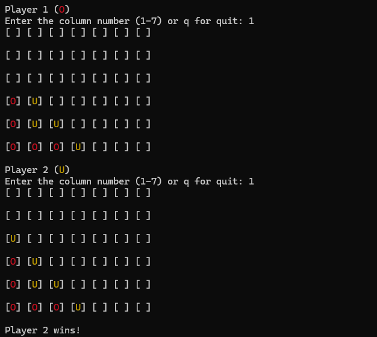

# Connect four
Terminal Connect Four game in Python

## Screenshot from the terminal


## Features
- Play against another player (hot-seat)
- Colored output in the terminal
- Quit anytime with `q`
- Draw detection when the board is full

## How to play
- Enter a column number (1-7) and press Enter.
- The chip falls to the lowest free cell in that column.
- First to line up 4 chips horizontally, vertically or diagonally wins.

## How to run
```bash
python connect_four.py
```